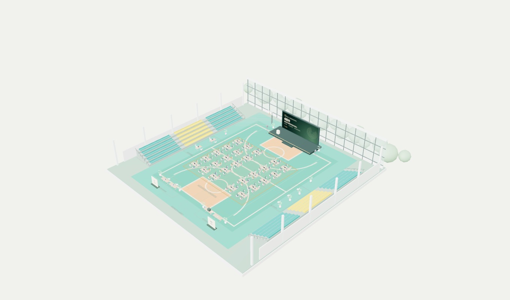

# scendance-scene-library · 幕景场景模板库

幕景（Scendance）的**完整场景模板库**：10 套可直接用于活动布置的场景，每套包含场馆结构、家具、设备、灯具和人物，按「固定结构 + 可编辑物件」拆分，可作为任何 3D 布置工作台的数据源。

本仓库是模板库的唯一存放处。`Scendance2026` 主仓不再保存这些 GLB、打包脚本或模板面板代码。

## 10 套场景

| key | 名称 | 卡片副标题 | 场地（概念尺寸） | 净高 | 可编辑物件 | 总览图 |
| --- | --- | --- | --- | ---: | ---: | --- |
| `gym` | 体育馆 · 黑客松 | 25 支团队 · 100 位参与者 | 70 × 76 m | 6 m | 307 | [预览](scene/templates/gym/previews/gym-overview.jpg) |
| `popup` | 青序 · 香氛快闪 | 12 × 8 米 · 24 位来访者 | 12 × 8 m | 3.5 m | 42 | [预览](scene/templates/popup/previews/popup-overview.jpg) |
| `bar` | 琥珀间 · 酒吧 | 12 × 9 米 · 吧台与 3 组卡座 | 12 × 9 m | 3.4 m | 38 | [预览](scene/templates/bar/previews/bar-overview.jpg) |
| `cafe` | 慢调咖啡 · SLOW NOTES | 12 × 9 米 · 咖啡吧台与 14 席 | 12 × 9 m | 3.25 m | 46 | [预览](scene/templates/cafe/previews/cafe-overview.jpg) |
| `conference` | 学术会议 · 共知 | 24 × 18 米 · 96 位观众 | 24 × 18 m | 5.3 m | 212 | [预览](scene/templates/conference/previews/conference-overview.jpg) |
| `lawn` | 室外草坪 · 旷野有约 | 28 × 20 米 · 60 位来宾 | 28 × 20 m | 4.3 m | 135 | [预览](scene/templates/lawn/previews/lawn-overview.jpg) |
| `market` | 风物市集 · 户外市集 | 30 × 22 米 · 12 个摊位 | 30 × 22 m | 4.3 m | 57 | [预览](scene/templates/market/previews/market-overview.jpg) |
| `museum` | 留白之间 · 美术馆展区 | 20 × 14 米 · 展厅与展品 | 20 × 14 m | 4.1 m | 23 | [预览](scene/templates/museum/previews/museum-overview.jpg) |
| `office` | 办公室 · 留白 | 14 × 10 米 · 8 个工位 | 14 × 10 m | 3.3 m | 76 | [预览](scene/templates/office/previews/office-overview.jpg) |
| `studio` | 留白 · 摄影工作室 | 12 × 10 米 · 摄影棚与器材 | 12 × 10 m | 4.3 m | 24 | [预览](scene/templates/studio/previews/studio-overview.jpg) |

合计 **960 件可编辑物件**。单位米、+Y 朝上；场地尺寸是概念/示意比例，**不是实测尺寸**，人数不代表核定容量，也未做承重、消防或人流仿真校验。



## 目录

```
scene/templates/<key>/
  <key>.glb              原始归档 GLB（不改动）
  template.json          上游归档说明：图层、物件清单、概念尺寸
  previews/<key>-overview.jpg
  ASSET-SOURCES.md       该套的模型来源与许可
  LICENSE.md             仅市场场景随归档附带的许可说明
scripts/package-scene-presets.mjs   拆结构 / 物件的转换器（零依赖）
scripts/package-scene-presets.d.mts 类型声明
scripts/build.mjs                   生成 dist/scene-presets/
docs/SCENE-PRESETS.md               每套的可编辑范围、分组规则、边界
```

## 构建

需要 Node.js ≥ 20。转换器只读 GLB 容器，不依赖 three.js 或任何 npm 包。

```bash
node scripts/build.mjs     # 产出 dist/scene-presets/<key>/{<key>.glb,preview.jpg}
```

产物结构：

- `Preset_Structure` —— 固定场馆（墙、地、舞台、固定灯架等），只读
- `Preset_Objects/Preset_Object_N` —— 可编辑物件，中文名在 `extras.displayName`

源 GLB 只重写 JSON 块，二进制块（几何与贴图）逐字节保留。天花板/屋面板与吊装灯具不进入可编辑视图；零厚度构件（如咖啡馆品牌标牌）留在固定结构，构建时会打印说明。

## 消费方式

任意 3D 运行时按需读取产物：`dist/scene-presets/<key>/<key>.glb` + 同目录 `preview.jpg` 作封面。物件的中文名、原始尺寸、离地高度都在 GLB 节点上，不需要额外接口。

## 许可与来源

- 原始归档来自 `LiliLIN0324/scendance` 的 `codex/gym-scene-template` 分支，固定提交 `f2ec7ebd58094e51b868528b1ff499bcd8ea9b0d`；另 8 套来自 `scene_v0.6.1` / `3d4d517`。
- 各目录的 `ASSET-SOURCES.md` 保留逐项模型来源、照片来源与许可声明。第三方模型按归档声明保留（多为 CC0 1.0）；**不将整个场景统称为 CC0**。
- 场景布局、建模、招牌与贴图为幕景项目原创；本仓库不额外授予或强加公共许可，详见 [LICENSE.md](LICENSE.md)。
